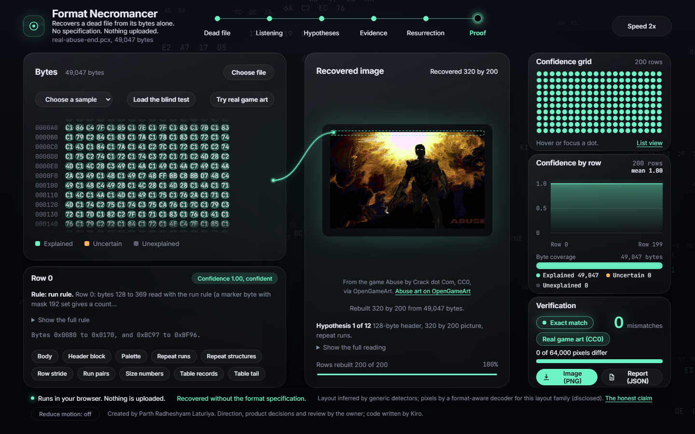
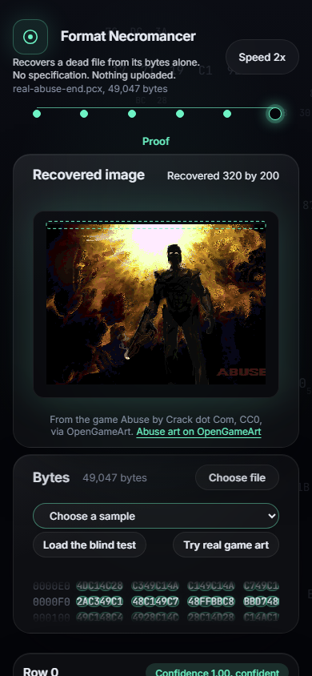
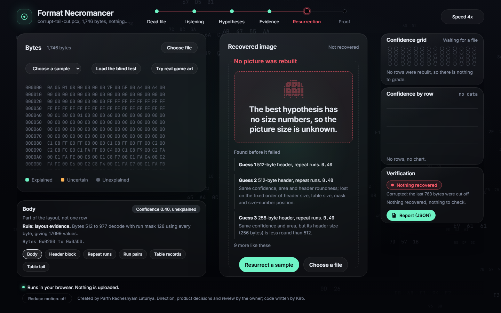

# Format Necromancer

Recovers a dead file from its bytes alone. No specification. Nothing uploaded.

**For** small museums, archives and anyone with old disks whose files no program opens. **Why:** it shows the evidence for every part it rebuilds, so you know how far to trust it, and it refuses to guess when a file is too damaged.

**Built with Kiro:** 3 specs, 7 steering files and 2 custom agents in [`.kiro/`](.kiro), work split across Kiro Crew sessions, and a judge-panel reviewer. Full list in [How Kiro built it](#how-kiro-built-it).

https://format-necromancer.vercel.app

[](https://github.com/parthlaturiya1/format_necromancer/actions/workflows/verify.yml)



- 5 of 5 real CC0 game files from Abuse rebuilt exact against Pillow: [wild-test.md](docs/verification/wild-test.md)
- Blind test exact, 0 of 13,500 pixels differ: [blind-test.md](docs/verification/blind-test.md)
- 297 changed files, 0 wrong at confidence 0.9 or more: [robustness-report.md](docs/verification/robustness-report.md)
- Runs in your browser, no network during analysis: [t19-golden-run.md](docs/verification/t19-golden-run.md)

Created by Parth Radheshyam Laturiya. Direction, product decisions and review by the owner; code written by Kiro.
## Vision

Today there is one layout family (PCX images), and every element of the result comes with its evidence. The same evidence-first method is meant to extend to other dead formats, which is not built yet.

## Try it in 30 seconds

1. Open https://format-necromancer.vercel.app (laptop or phone, no login).
2. Press **Resurrect a sample**. The bytes of a real CC0 game file (real-abuse-end.pcx, 49,047 bytes, from the game Abuse) turn into a picture in six steps. **Skip to result** jumps to the end.
3. Click a row of the picture, or a dot in the Confidence Grid (each dot is one row). The matching bytes light up, with the rule and a confidence value.
4. Read the verification panel. It says **Exact match** and "0 of 64,000 pixels differ".
5. Press **Load the blind test** (in the Bytes panel). This file was never used for tuning. Read its verification.
6. Open **Try a sample** and pick corrupt-tail-cut. The file is cut short. The app shows "No picture was rebuilt" and the reason, and does not guess.
7. In **Try a sample**, pick signature-changed. Its first byte was changed, so a standard decoder refuses it. The engine still recovers it exactly.

Your own file: press **Choose file**. With no reference picture, the app says nothing here proves it correct. **Download image** and **Download evidence report** save the result. **Reduce motion** and **Speed** are in the page.

| On a phone | When a file is too damaged |
|---|---|
|  |  |
| The live site at 390 px wide. | No picture, the reason, and the guesses it found. It does not guess a picture. |
## What it is

Format Necromancer recovers a picture from an old file that nothing opens, using only the file's bytes. It studies the bytes, works out the layout, rebuilds the picture, shows which bytes and which rule produced every part, and checks the result against a trusted reference. When a damaged file cannot be rebuilt, the app shows no picture and gives the reason in plain words. Everything runs in your browser. Nothing is uploaded.

## Who it is for, and why

Staff and volunteers at small archives, libraries and museums, and anyone with old disks. Scenario: a volunteer at a local museum finds a box of floppy disks with scanned photos in an old picture format. The program that wrote them is gone and the documentation with it. Today they must guess which tool might open each file. Here they drop the file in and see a recovered picture, plus the evidence for each part, so they know how far to trust it.

Scale, as upper bounds and not users. These are the numbers of places that hold collections. They do not count people who need this tool.
- About 104,000 museums worldwide, in 2021 ([UNESCO](https://www.unesco.org/en/articles/supporting-museums-unesco-report-points-options-future)).
- Library counts are left out. The IFLA [Library Map of the World](https://librarymap.ifla.org/) holds them, but its pages could not be opened to check a number.

## The honest claim

Recovered without using the specification, tested on a held-out file and on files with altered headers.

- **Generic part.** The detectors (structure, repetition, palettes) carry no format name and no spec constants.
- **Format-aware part, disclosed.** A small labelled decoder per hypothesis family turns an inferred layout into pixels. This decoder knows the shape of the format it decodes. The app does not claim to open any old file.
- **Format covered.** One format: PCX images.
- One held-out file does not prove the engine works in general.

## Results

Every number comes from a report in this repo.

| Check | Result | Report |
|---|---|---|
| Real files, 5 (W-1) | 5 of 5 exact: 0 mismatches against Pillow's decode (truth: Pillow 13.0.0). CC0 files from the game Abuse, run once each with no tuning. All are 8-bit palette PCX with run-length coding, from one source. | [wild-test.md](docs/verification/wild-test.md) |
| Blind test, 1 held-out file (150 x 90) | Exact: 0 of 13,500 pixels differ from Pillow's decode, confidence 1. Engine time 17.7 ms. | [blind-test.md](docs/verification/blind-test.md) |
| Mutated files, 297 | 0 wrong at confidence 0.9 or more. 57 exact, 195 unrecovered, 45 wrong at confidence below 0.9 (max 0.85), shown as uncertain. | [robustness-report.md](docs/verification/robustness-report.md) |
| Fuzz, 3002 cases | 0 crashes. Slowest case 40 ms. | [robustness-report.md](docs/verification/robustness-report.md) |
| Tuning samples, 11 | 11 of 11 exact against the reference. | [golden-report.md](docs/verification/golden-report.md) |
| Regression gate | Deliberate break of one setting was caught. Four other deliberate breaks were not caught (disclosed). | [regression-report.md](docs/verification/regression-report.md) |
| Frame rate, reveal at 1x, headless Chromium | On a host with 3 to 4.7 GB free memory: p50 59.9 fps, p95 59.5 fps (16.8 ms). On a host with about 2 GB free: p50 59.9 fps in 3 of 4 runs (one run 30), p95 dropped to 15 to 20 fps and failed the 55 fps bar. Frame rate depends on host memory. Not measured on a real GPU or phone. | [t17-hud.md](docs/verification/t17-hud.md), [t18-failure.md](docs/verification/t18-failure.md) |
| Failure flow (T-18) | corrupt-tail-cut (last 768 bytes cut) ends with no picture and the engine's reason. The corrupted-tail cases end unrecovered for 21 of 44 files in the mutation set. | [t18-failure.md](docs/verification/t18-failure.md) |
| Signature-changed sample (T-18) | First byte changed: exact, 0 of 12,321 pixels differ, checked against the source sample's reference. | [t18-failure.md](docs/verification/t18-failure.md) |
| Budgets (T-21c) | Enforced in `npm run verify` step 8 and in CI: landing JS under 250,000 bytes gzipped, engine under 3 s on 1 MiB and on every tuning sample. Lighthouse is not configured. | [t21c-budgets.md](docs/verification/t21c-budgets.md) |
| Large files (T-21d) | A valid 10.4 MB file is rebuilt exact in 1,591 ms. Nine 10 MB attack files each end unrecovered with a reason, the slowest at 2,762 ms. Times are from one busy machine. | [t21d-large-files.md](docs/verification/t21d-large-files.md) |
| Full gate | `npm run verify`: see the latest run | [latest.md](docs/verification/latest.md) |

Limits. The blind-test file comes from the same generator as the tuning files. The five real files (W-1) come from one game and one export tool, all in the one family the engine targets. Five files are not a rate, and say nothing about 24-bit, 1-bit, 4-bit, multi-plane or damaged real files. Lighthouse is not configured. Only the numbers above were measured.

## How Kiro built it

- **Specs (3, in EARS form):** `.kiro/specs/engine`, `recovery`, `experience`. Each has requirements, design and tasks.
- **Steering (7 files):** `.kiro/steering/` (product, tech, design, testing, provenance, demo, roadmap), plus `AGENTS.md` at the root.
- **Custom agents (2):** `engine-engineer` and `verifier` in `.kiro/agents/`. The verifier may not write under `src/`.
- **Kiro Crew:** a conductor session split the roadmap into tasks. Worker sessions did each task, and fresh reviewer sessions checked the design (five design reviews, R-1 to R-5, are `docs/verification/review-t13.md` to `review-t17.md`; a judge-panel gap review, J-1, is [judge-gap-review.md](docs/verification/judge-gap-review.md)).
- **Kiro IDE:** two tasks were done in the Kiro IDE: T-11b (a guard that detects changed detector settings) and T-21a (a security self-review, `docs/security.md`).
- **Property-based tests:** fast-check, used for the fuzz runs above.
- **Provenance ledger:** `docs/provenance/ledger.jsonl`, append only. The Kiro agent hooks could not be activated in this Kiro version, so a script (`scripts/provenance/record.mjs`) writes one entry per task. `npm run provenance:check` lists committed changes with no entry as `UNATTRIBUTED`. The count of such warnings is in `docs/verification/latest.md`. They are disclosed, not hidden. Details: [AUTHORSHIP.md](AUTHORSHIP.md).

`.kiro` is committed at `.kiro/` in this repo.

## Related work

Different tools, with different goals. Each line below comes from the tool's own page; sources and dates are in [docs/verification/t24c-related-work.md](docs/verification/t24c-related-work.md).

- [Kaitai Struct](https://github.com/kaitai-io/kaitai_struct) (with its Web IDE visualizer): a "declarative language" for describing binary formats in a `.ksy` file, compiled into parsers. [ImHex](https://github.com/WerWolv/ImHex): a hex editor with a "pattern language" for parsing and highlighting a file, loaded automatically by MIME type and magic value.
  Contrast: both parse a file with a format description a person writes first. Format Necromancer infers the layout from the bytes and shows evidence per element.
- [PolyFile](https://github.com/trailofbits/polyfile): a tool to "identify and map the semantic and syntactic structure of files", with a pure-Python libmagic and Kaitai Struct parsers, plus an interactive hex viewer.
  Contrast: its identification and mapping rely on magic-value matchers and format parsers that already exist. Format Necromancer targets a format with no parser, and recovers the layout from the bytes.
- [Oscura](https://pypi.org/project/oscura/) (PyPI page; its GitHub repository returned 404 when we checked): a Python framework for hardware reverse engineering. Its page lists protocol inference, including field detection and format identification.
  Contrast: Oscura also infers structure from data, so inference is not unique to us. Its focus is hardware signals and protocols (oscilloscope captures, Wireshark dissectors). Ours is a dead file format, in the browser. UNKNOWN how the two compare on the same input.

We have not benchmarked these tools; this is a description, not a comparison of results.
## Run locally

Requires Node 22.12 or newer (CI pins Node 22).

```
npm ci
npx playwright install chromium    # once; on a CI machine: npx playwright install --with-deps chromium
npm run verify                     # about 5 minutes
npm run dev
```

`npm run verify` runs the full gate and writes `docs/verification/latest.md`. The end-to-end step needs the Playwright browser from the install line above.

The wall-clock bars (first result within 9 s, no hex task over 50 ms) run in the `npm run perf` step, which `verify` calls. On CI it skips itself and says why; see [docs/verification/c1-ci-green.md](docs/verification/c1-ci-green.md). On Windows with script execution disabled, use `npm.cmd` and `npx.cmd`.

## Privacy

Files never leave your browser. See [docs/privacy.md](docs/privacy.md).

## License

MIT. See [LICENSE](LICENSE).
