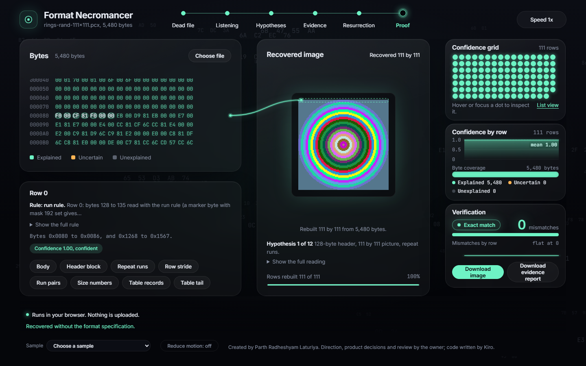

https://format-necromancer.vercel.app

# Format Necromancer



Created by Parth Radheshyam Laturiya. Direction, product decisions and review by the owner; code written by Kiro.

## Vision

Today there is one layout family (PCX images), and every element of the result comes with its evidence. The same evidence-first method is meant to extend to other dead formats, which is not built yet.

## Try it in 30 seconds

1. Open https://format-necromancer.vercel.app (laptop or phone, no login).
2. Press **Resurrect a sample**. A dead file's bytes turn into a picture in six steps. **Skip to result** jumps to the end.
3. Click a row of the picture, or a dot in the Confidence Grid (each dot is one row). The matching bytes light up, with the rule and a confidence value.
4. Read the verification panel. It says **Exact match** and a line such as "0 of 12,321 pixels differ".
5. Press **Load the blind test** (in the Bytes panel). This file was never used for tuning. Read its verification.
6. Open **Try a sample** and pick corrupt-tail-cut. The file is cut short. The app shows "No picture was rebuilt" and the reason, and does not guess.
7. In **Try a sample**, pick signature-changed. Its first byte was changed, so a standard decoder refuses it. The engine still recovers it exactly.

Your own file: press **Choose file**. With no reference picture, the app says nothing here proves it correct. **Download image** and **Download evidence report** save the result. **Reduce motion** and **Speed** are in the page.
## What it is

Format Necromancer recovers a picture from an old file that nothing opens, using only the file's bytes. It studies the bytes, works out the layout, rebuilds the picture, shows which bytes and which rule produced every part, and checks the result against a trusted reference. When a damaged file cannot be rebuilt, the app shows no picture and gives the reason in plain words. Everything runs in your browser. Nothing is uploaded.

## Who it is for, and why

Staff and volunteers at small archives, libraries and museums, and anyone with old disks. Scenario: a volunteer at a local museum finds a box of floppy disks with scanned photos in an old picture format. The program that wrote them is gone and the documentation with it. Today they must guess which tool might open each file. Here they drop the file in and see a recovered picture, plus the evidence for each part, so they know how far to trust it.

Scale, as upper bounds and not users. These are the numbers of places that hold collections. They do not count people who need this tool.
- About 104,000 museums worldwide (UNESCO, as reported by UN News).
- More than 80,000 academic libraries (IFLA Library Map of the World).
- About 408,000 public libraries (a national library summary of IFLA data).

## The honest claim

Recovered without using the specification, tested on a held-out file and on files with altered headers.

- **Generic part.** The detectors (structure, repetition, palettes) carry no format name and no spec constants.
- **Format-aware part, disclosed.** A small labelled decoder per hypothesis family turns an inferred layout into pixels. This decoder knows the shape of the format it decodes. The app does not claim to open any old file.
- **Format covered.** One format: PCX images.
- One held-out file does not prove the engine works in general.

## Results

Every number comes from a report in this repo.

| Check | Result | Report |
|---|---|---|
| Blind test, 1 held-out file (150 x 90) | Exact: 0 of 13,500 pixels differ from Pillow's decode, confidence 1. Engine time 17.7 ms. | [blind-test.md](docs/verification/blind-test.md) |
| Mutated files, 297 | 0 wrong at confidence 0.9 or more. 57 exact, 195 unrecovered, 45 wrong at confidence below 0.9 (max 0.85), shown as uncertain. | [robustness-report.md](docs/verification/robustness-report.md) |
| Fuzz, 3002 cases | 0 crashes. Slowest case 40 ms. | [robustness-report.md](docs/verification/robustness-report.md) |
| Tuning samples, 11 | 11 of 11 exact against the reference. | [golden-report.md](docs/verification/golden-report.md) |
| Regression gate | Deliberate break of one setting was caught. Four other deliberate breaks were not caught (disclosed). | [regression-report.md](docs/verification/regression-report.md) |
| Frame rate, reveal at 1x, headless Chromium | On a host with 3 to 4.7 GB free memory: p50 59.9 fps, p95 59.5 fps (16.8 ms). On a host with about 2 GB free: p50 59.9 fps in 3 of 4 runs (one run 30), p95 dropped to 15 to 20 fps and failed the 55 fps bar. Frame rate depends on host memory. Not measured on a real GPU or phone. | [t17-hud.md](docs/verification/t17-hud.md), [t18-failure.md](docs/verification/t18-failure.md) |
| Failure flow (T-18) | corrupt-tail-cut (last 768 bytes cut) ends with no picture and the engine's reason. The corrupted-tail cases end unrecovered for 21 of 44 files in the mutation set. | [t18-failure.md](docs/verification/t18-failure.md) |
| Signature-changed sample (T-18) | First byte changed: exact, 0 of 12,321 pixels differ, checked against the source sample's reference. | [t18-failure.md](docs/verification/t18-failure.md) |
| Full gate | `npm run verify`: see the latest run | [latest.md](docs/verification/latest.md) |

Limits. The blind-test file comes from the same generator as the tuning files, so it shows the path works on a file never seen, not that it works on real-world files. The verify step for performance budgets is a stub, so the budgets in `.kiro/steering/tech.md` (D-10) are not all enforced by the gate. Only the numbers above were measured.

## How Kiro built it

- **Specs (3, in EARS form):** `.kiro/specs/engine`, `recovery`, `experience`. Each has requirements, design and tasks.
- **Steering (7 files):** `.kiro/steering/` (product, tech, design, testing, provenance, demo, roadmap), plus `AGENTS.md` at the root.
- **Custom agents (2):** `engine-engineer` and `verifier` in `.kiro/agents/`. The verifier may not write under `src/`.
- **Kiro Crew:** a conductor session split the roadmap into tasks. Worker sessions did each task, and fresh reviewer sessions checked the design (five design reviews, R-1 to R-5, are `docs/verification/review-t13.md` to `review-t17.md`; a judge-panel gap review, J-1, is [judge-gap-review.md](docs/verification/judge-gap-review.md)).
- **Kiro IDE:** one task (T-11b, a guard that detects changed detector settings) was done in the Kiro IDE.
- **Property-based tests:** fast-check, used for the fuzz runs above.
- **Provenance ledger:** `docs/provenance/ledger.jsonl`, append only. The Kiro agent hooks could not be activated in this Kiro version, so a script (`scripts/provenance/record.mjs`) writes one entry per task. `npm run provenance:check` lists committed changes with no entry as `UNATTRIBUTED`. The latest run lists 560 such warnings (see `docs/verification/latest.md`). They are disclosed, not hidden. Details: [AUTHORSHIP.md](AUTHORSHIP.md).

`.kiro` is committed at `.kiro/` in this repo.

## Related work

Different tools, with different goals. Facts are from each project's own pages.
- [Kaitai Struct](https://kaitai.io): a declarative language that describes binary formats and generates parsers. It needs a written description of the format.
- [ImHex](https://github.com/WerWolv/ImHex): a hex editor with its own pattern language that defines structures to parse and highlight a file.
- [PolyFile](https://github.com/trailofbits/polyfile): identifies and maps the structure of files, with a pure-Python libmagic and Kaitai Struct grammars.
- [Oscura](https://pypi.org/project/oscura/): a Python framework for hardware reverse engineering (signal analysis, protocol decoding).

How they compare with Format Necromancer on recovering an unknown format: UNKNOWN. We have not tested them, so we make no claim.

## Run locally

Requires Node 22.12 or newer.

```
npm ci
npm run verify
npm run dev
```

`npm run verify` runs the full gate and writes `docs/verification/latest.md`. The end-to-end step needs Playwright's browser: run `npx playwright install chromium` once first.

## Privacy

Files never leave your browser. See [docs/privacy.md](docs/privacy.md).

## License

MIT. See [LICENSE](LICENSE).

Created by Parth Radheshyam Laturiya. Direction, product decisions and review by the owner; code written by Kiro.
